    

    

    

## 📑 Sumário

+ [📃 Prefácio](#-prefácio)
+ [✨ Características](#-características)
+ [📥 Instalação](#-instalação)
+ [🎛️ Personalização](#️-personalização)
+ [🔍 Recursos em Detalhe](#-recursos-em-detalhe)
    + [🌑 Tons de Fundo](#-tons-de-fundo)
    + [🎨 Paleta de Cores](#-paleta-de-cores)
    + [💬 Estilos de Callout](#-estilos-de-callout)
    + [📝 Estilo das Notas](#-estilo-das-notas)
    + [✅ Checkboxes de Tarefa](#-checkboxes-de-tarefa)
    + [🧱 Layout Plano](#-layout-plano)
    + [🗂️ Explorador e Elementos Flutuantes](#️-explorador-e-elementos-flutuantes)
    + [🗃️ Abas](#️-abas)
+ [🧩 Compatibilidade](#-compatibilidade)
+ [☕ Caso você goste do tema](#-caso-você-goste-do-tema)
+ [📬 Feedback e Suporte](#-feedback-e-suporte)
+ [📄 Créditos e Licença](#-créditos-e-licença)

## 📃 Prefácio

Este tema nasceu da necessidade de ter um cantinho calmo para escrever à noite: um roxo bem escuro, bordas discretas e um texto que não cansa os olhos. Foi feito primeiro para o meu próprio uso, então talvez não atenda a tudo o que você precisa. Mas, se ele combinar com o seu jeito de escrever e pensar, fico feliz em dividi-lo com você.

Para que ele possa ser seu também, deixei algumas opções no plugin **Style Settings**, onde você pode personalizar paletas de cor, tons de fundo, tipografia e mais. Sem o plugin, o tema funciona normalmente com o visual padrão.

Ele também é fruto de aprendizado. Usei ferramentas de IA como companhia durante o desenvolvimento, para entender melhor cada parte do CSS enquanto construía o tema. Ele continua evoluindo.

Fique à vontade para usar, adaptar ao seu gosto e sugerir melhorias. Seja bem-vindo(a).

## ✨ Características

O Moonshade é simples de propósito: não reinventa o Obsidian, só o deixa mais calmo para escrever à noite. Os detalhes que ele cuida:

- **Só modo escuro**, em roxo bem escuro, com dois tons de fundo.
- **Doze paletas** que trocam de uma vez a cor de destaque, as cores das pastas e as bordas e setas do Canvas. Os arquivos mantêm uma cor fixa.
- **Cantos arredondados** ajustáveis de 0 a 20 px em abas, botões, tabelas, citações e molduras.
- **Layout plano:** explorador, editor e barra lateral colados, com molduras de cima arredondadas e ligadas por linhas finas. Funciona com tela dividida e com as barras laterais recolhidas.
- **Explorador com ícones** para pastas, notas, Bases, Canvas, imagens e PDFs, com a extensão (`.png`, `.base`, `.canvas`...) em uma etiqueta discreta no fim da linha. As notas `.md` ficam sem etiqueta.
- **Abas compactas**, com a aba ativa maior e sublinhada na cor de destaque, ou as abas padrão do Obsidian, se preferir. As abas empilhadas também têm visual próprio.
- **Seis estilos de callout** à escolha (padrão, barra lateral, cabeçalho em faixa, minimalista, etiqueta e cartão com sombra), com cores e ícones também para os tipos em português (`> [!dica]`, `> [!aviso]`...).
- **Notas bem acabadas:** títulos em degraus nítidos, tabelas, citações, callouts, blocos de código, propriedades e tags com a mesma borda e o mesmo arredondamento.
- **Tipografia à escolha:** fonte do texto, dos títulos, da interface e do código (com opção para desligar ligaduras), além do tamanho do texto, da altura da linha e da largura da coluna.
- **Interface flutuante:** barra de status, perfil do cofre e botões do explorador em pílulas com borda e sombra suave (dá para voltar ao clássico), botões da janela em traço fino e barras de rolagem discretas.
- **Checkboxes de tarefa com 22 estados:** além de pendente e feito, mais 20 estados (`- [/]`, `- [>]`, `- [!]`, `- [I]`...), cada um com ícone e cor próprios, e uma opção para trocar tudo por ícones Lucide sem caixa.
- **Canvas, Bases e Kanban** estilizados no mesmo visual.
- **Animações suaves**, com velocidade ajustável, que respeitam a opção do sistema de reduzir movimento.
- **Exportação para PDF** em papel claro, mesmo com o tema escuro.
- **Funciona sem plugins.** O Style Settings só acrescenta as opções.

> [!IMPORTANT]
> O tema existe apenas no modo escuro, não aplicando nada no modo claro do Obsidian.

## 📥 Instalação

**Pelo Obsidian:**

>1. Abra _Configurações → Aparência_ e, em _Temas_, clique em **Gerenciar**.
>2. Procure por **Moonshade** e clique em **Instalar e usar**.

**Manualmente:**

>1. Baixe `theme.css` e `manifest.json` deste repositório.
>2. Coloque os dois arquivos em `<seu cofre>/.obsidian/themes/Moonshade/`.
>3. Em _Configurações → Aparência_, selecione o tema.

**Opcional:** instale o plugin [Style Settings](https://github.com/mgmeyers/obsidian-style-settings) para personalizar fundo, paletas e muito mais.

## 🎛️ Personalização

Com o Style Settings instalado, as opções ficam em _Configurações → Style Settings → Moonshade_.

| Grupo | O que você ajusta |
| --- | --- |
| **Cores** | Paleta de cores e tom do fundo |
| **Formato** | Arredondamento dos cantos e largura do texto da nota |
| **Texto e tabelas** | Tamanho do texto, altura da linha, espaçamento das tabelas, estilo dos callouts e ícones Lucide nos checkboxes |
| **Tipografia** | Fonte do texto, dos títulos, da interface e do código, e ligaduras |
| **Interface** | Barras de rolagem, velocidade das animações, rolagem suave, barra de status, perfil do cofre e botões do explorador clássicos, e abas padrão do Obsidian |

## 🔍 Recursos em Detalhe

Cada recurso abaixo mostra como ele fica e onde ajustá-lo no Style Settings.

### 🌑 Tons de Fundo

 

O Moonshade não tem modo claro, mas oferece dois tons de fundo escuros. A escolha muda a base de todo o Obsidian: painéis, barra lateral e editor.

- **Profunda:** o mais escuro, quase preto. Tem mais contraste com o texto e dá um ar mais intenso e marcante ao tema.
- **Noite:** um degrau mais claro, com um roxo-azulado que deixa tudo mais suave e calmo, como a noite. É a escolha para quem prefere menos contraste.

> [!NOTE]
> **Para trocar:** _Configurações → Style Settings → Moonshade → Tom do fundo._

### 🎨 Paleta de Cores

 

O tema possui doze paletas de cores diferentes: Lua, Lavanda, Oceano, Céu, Aurora, Bosque, Mel, Âmbar, Pêssego, Rubi, Crepúsculo e Névoa. Cada uma muda de uma vez a cor de destaque (links, listas, itens selecionados, borda da janela ativa e tags), as pastas, as cores do gráfico e as bordas e setas do Canvas (as que não têm cor própria). Os arquivos mantêm uma cor fixa.

> [!NOTE]
> **Para trocar:** _Configurações → Style Settings → Moonshade → Paleta de cores._

### 💬 Estilos de Callout

 

Os blocos de aviso (`> [!note]`, `> [!tip]`...) têm seis aparências. O que muda é só o formato (borda, barra, cabeçalho, etiqueta ou sombra); a cor de cada tipo continua a mesma em todos. Há também cores e ícones para os nomes em português, como `dica`, `aviso`, `erro` e `exemplo`.

> [!NOTE]
> **Para trocar:** _Configurações → Style Settings → Moonshade → Estilo dos callouts._

### 📝 Estilo das Notas

 

O texto da nota foi pensado para leitura longa à noite:

- **Títulos:** degraus de tamanho nítidos do H1 ao H5. O H6 é pequeno e apagado, para servir de rótulo.
- **Texto corrido:** entrelinha de 1,7 e negrito um pouco mais claro. Os links só sublinham ao passar o mouse, e os que apontam para notas que não existem mantêm a aparência de link não resolvido do Obsidian, para você notar.
- **Destaques e listas:** o destaque `==assim==` tem fundo suave e cantos arredondados, e os marcadores das listas usam a cor de destaque da paleta.
- **Tabelas, citações e código:** fundo em tom, borda de 1 px e cantos arredondados, como nos callouts.
- **Tarefas:** checkbox arredondada e 20 estados extras, explicados na seção _Checkboxes de Tarefa_, logo abaixo.

> [!NOTE]
> **Para ajustar:** _Configurações → Style Settings → Moonshade._ Em **Formato** ficam a largura do texto e o arredondamento; em **Texto e tabelas**, o tamanho do texto, a altura da linha, o espaçamento das tabelas, o estilo dos callouts e os ícones dos checkboxes; em **Tipografia**, as fontes.

### ✅ Checkboxes de Tarefa

 

Além do pendente `- [ ]` e do feito `- [x]`, escreva outro caractere dentro dos colchetes para marcar o estado da tarefa, como `- [/] Escrever as notas da versão`. São 20 estados extras, cada um com ícone e cor próprios, e os caracteres seguem a convenção de temas como o Minimal, então notas que já usam esses estados continuam funcionando.

| Estado | Caractere | Estado | Caractere | Estado | Caractere |
| --- | --- | --- | --- | --- | --- |
| Em andamento | `[/]` | Estrela | `[*]` | Local | `[l]` |
| Cancelado | `[-]` | Ideia | `[I]` | Economia | `[S]` |
| Adiado | `[>]` | Urgente | `[f]` | A favor | `[p]` |
| Agendado | `[<]` | Chave | `[k]` | Contra | `[c]` |
| Importante | `[!]` | Vitória | `[w]` | Sobe | `[u]` |
| Pergunta | `[?]` | Citação | `["]` | Desce | `[d]` |
| Informação | `[i]` | Favorito | `[b]` | | |

Por padrão, cada estado aparece em uma caixa tingida com a cor dele, e só o cancelado `[-]` fica riscado e apagado. As letras diferenciam maiúsculas de minúsculas: `[i]` é informação e `[I]` é ideia.

Se preferir, ligue **Ícones Lucide nos checkboxes**: some a caixa e fica só o ícone, do mesmo tamanho dela. O pendente vira um círculo vazio, só com o contorno, e o feito e todos os estados extras viram ícones preenchidos na cor do estado.

> [!NOTE]
> **Para trocar:** _Configurações → Style Settings → Moonshade → Ícones Lucide nos checkboxes._

### 🧱 Layout Plano

 

O Moonshade não usa painéis soltos em cartões. O explorador, o editor e a barra lateral direita são planos, colados e separados por linhas finas; os cantos de cima são arredondados e as curvas se encontram na divisória, sem vão. A cor de destaque só aparece quando você passa o mouse na divisória para redimensionar.

Na **tela dividida**, a linha entre os painéis é recortada como num navegador: um trecho curto na faixa das abas e o trecho normal logo abaixo, sempre alinhados.

 

Com uma barra lateral recolhida, o editor encosta na linha do ribbon (esquerda) ou na borda da janela (direita), como no Obsidian.

### 🗂️ Explorador e Elementos Flutuantes

 

Pastas, notas, Bases, Canvas, imagens e PDFs têm ícones próprios, e a extensão aparece numa etiqueta à direita (as notas `.md` ficam sem ela). A cor das pastas segue a paleta; a dos arquivos é fixa.

 

A barra de status, o perfil do cofre e os botões do explorador flutuam em pílulas, com borda, desfoque e uma sombra suave. Os três podem voltar ao visual clássico, cada um por uma opção própria no Style Settings: barra de status clássica, perfil do cofre clássico e botões do explorador clássicos.

### 🗃️ Abas

 

As abas do Moonshade são pílulas compactas, com a aba ativa maior e sublinhada. Se preferir o estilo do Obsidian, ligue **Abas padrão do Obsidian**; o modo de abas empilhadas tem visual próprio e não muda.

> [!NOTE]
> **Para trocar:** _Configurações → Style Settings → Moonshade → Abas padrão do Obsidian._

## 🧩 Compatibilidade

| | |
| --- | --- |
| **Obsidian** | 1.4.0 ou superior (a estilização de Bases exige o Obsidian 1.9 ou superior) |
| **Versão** | 1.0.0 · [notas de versão](https://github.com/ibridd/moonshade/releases) |
| **Modo** | Somente escuro |
| **Plugins** | Style Settings (opcional). Canvas, Bases e Kanban estilizados |
| **Plataforma** | Pensado para desktop. No celular funciona com ajustes básicos |

## ☕ Caso você goste do tema

Ele é gratuito e serve também como minha forma de aprendizado. Se quiser contribuir com um cafezinho (ou salvar minha coluna e as noites mal dormidas), o link está aqui:

## 📬 Feedback e Suporte

Encontrou um bug ou tem uma sugestão? Abra uma [issue](https://github.com/ibridd/moonshade/issues) no repositório.

## 📄 Créditos e Licença

- Licença [MIT](LICENSE).
- Ícones do explorador e dos checkboxes de tarefa baseados no [Lucide](https://lucide.dev) (licença ISC).
- Personalização pelo plugin [Style Settings](https://github.com/mgmeyers/obsidian-style-settings), de mgmeyers.

---

    

