    

---

    

    <b><a href="README.pt.md">Portuguese</a> / English</b>

### 📑 Contents

+ [📃 Foreword](#-foreword)
+ [✨ Features](#-features)
+ [📥 Installation](#-installation)
+ [🎛️ Customization](#️-customization)
+ [🔍 In Detail](#-in-detail)
    + [🌑 Background Tones](#-background-tones)
    + [🎨 Color Palettes](#-color-palettes)
    + [💬 Callout Styles](#-callout-styles)
    + [📝 Note Styling](#-note-styling)
    + [✅ Task Checkboxes](#-task-checkboxes)
    + [🧱 Flat Layout](#-flat-layout)
    + [🗂️ File Explorer and Floating Elements](#️-file-explorer-and-floating-elements)
    + [🗃️ Tabs](#️-tabs)
+ [🧩 Compatibility](#-compatibility)
+ [☕ If you like the theme](#-if-you-like-the-theme)
+ [📬 Feedback and Support](#-feedback-and-support)
+ [📄 Credits and License](#-credits-and-license)

---

### 📃 Foreword

This theme was born from the need for a calm little corner to write at night: a very dark purple, subtle borders and text that doesn't tire the eyes. It was made for my own use first, so it may not cover everything you need. But if it fits the way you write and think, I'm happy to share it with you.

So that it can be yours too, I left some options in the **Style Settings** plugin, where you can customize color palettes, background tones, typography and more. Without the plugin, the theme works normally with its default look.

It is also the result of learning. I used AI tools as a companion during development, to better understand each part of the CSS while building the theme. It keeps evolving.

Feel free to use it, adapt it to your taste and suggest improvements. Welcome.

> [!NOTE]
> **About the interface language:** the Style Settings menu of the theme is currently in Portuguese. In this document, option names appear in Portuguese, followed by the English meaning in parentheses.

---

### ✨ Features

Moonshade is simple on purpose: it doesn't reinvent Obsidian, it just makes it calmer for writing at night. What it takes care of:

- **Dark mode only**, in a very dark purple, with two background tones.
- **Twelve palettes** that change the accent color, the folder colors and the Canvas borders and arrows all at once. Files keep a fixed color.
- **Rounded corners** adjustable from 0 to 20 px on tabs, buttons, tables, quotes and frames.
- **Flat layout:** file explorer, editor and right sidebar side by side, with rounded top frames joined by thin lines. Works with split view and with collapsed sidebars.
- **File explorer with icons** for folders, notes, Bases, Canvas, images and PDFs, with the extension (`.png`, `.base`, `.canvas`...) in a discreet tag at the end of the line. `.md` notes have no tag.
- **Compact tabs**, with a larger active tab underlined in the accent color, or Obsidian's default tabs if you prefer. Stacked tabs also have their own look.
- **Six callout styles** to choose from (default, side bar, banner header, minimal, label and shadow card), with colors and icons also for types in Portuguese (`> [!dica]`, `> [!aviso]`...).
- **Polished notes:** sharp heading steps, tables, quotes, callouts, code blocks, properties and tags with the same border and the same rounding.
- **Typography of your choice:** font for text, headings, interface and code (with an option to turn ligatures off), plus text size, line height and column width.
- **Floating interface:** status bar, vault profile and explorer buttons as pills with a border and soft shadow (you can go back to the classic look), thin window buttons and discreet scrollbars.
- **Task checkboxes with 22 states:** besides pending and done, 20 more states (`- [/]`, `- [>]`, `- [!]`, `- [I]`...), each with its own icon and color, and an option to swap everything for Lucide icons with no box.
- **Canvas, Bases and Kanban** styled in the same look.
- **Smooth animations**, with adjustable speed, that respect the system's reduce-motion setting.
- **PDF export** on light paper, even with the dark theme.
- **Works without plugins.** Style Settings only adds the options.

> [!IMPORTANT]
> The theme exists only in dark mode and applies nothing in Obsidian's light mode.

---

### 📥 Installation

**From Obsidian:**

>1. Open _Settings → Appearance_ and, under _Themes_, click **Manage**.
>2. Search for **Moonshade** and click **Install and use**.

**Manually:**

>1. Download `theme.css` and `manifest.json` from this repository.
>2. Put both files in `<your vault>/.obsidian/themes/Moonshade/`.
>3. In _Settings → Appearance_, select the theme.

**Optional:** install the [Style Settings](https://github.com/mgmeyers/obsidian-style-settings) plugin to customize the background, palettes and much more.

---

### 🎛️ Customization

With Style Settings installed, the options are in _Settings → Style Settings → Moonshade_.

| Group | What you can adjust |
| --- | --- |
| **Cores** (Colors) | Color palette and background tone |
| **Formato** (Shape) | Corner rounding and note text width |
| **Texto e tabelas** (Text and tables) | Text size, line height, table spacing, callout style and Lucide icons in checkboxes |
| **Tipografia** (Typography) | Font for text, headings, interface and code, and ligatures |
| **Interface** | Scrollbars, animation speed, smooth scrolling, classic status bar, vault profile and explorer buttons, and Obsidian's default tabs |

---

### 🔍 In Detail

Each feature below shows how it looks and where to adjust it in Style Settings.

### 🌑 Background Tones

 

Moonshade has no light mode, but it offers two dark background tones. The choice changes the base of all of Obsidian: panels, sidebar and editor.

- **Profunda (Deep):** the darkest, almost black. It has more contrast with the text and gives the theme a more intense, striking feel.
- **Noite (Night):** one step lighter, with a bluish purple that makes everything softer and calmer, like the night. It's the choice for those who prefer less contrast.

> [!NOTE]
> **To change it:** _Settings → Style Settings → Moonshade → **Tom do fundo** (Background tone)._

### 🎨 Color Palettes

 

The theme has twelve different color palettes: Lua (Moon), Lavanda (Lavender), Oceano (Ocean), Céu (Sky), Aurora, Bosque (Forest), Mel (Honey), Âmbar (Amber), Pêssego (Peach), Rubi (Ruby), Crepúsculo (Twilight) and Névoa (Mist). Each one changes, all at once, the accent color (links, lists, selected items, active window border and tags), the folders, the graph colors and the Canvas borders and arrows (those without a color of their own). Files keep a fixed color.

> [!NOTE]
> **To change it:** _Settings → Style Settings → Moonshade → **Paleta de cores** (Color palette)._

### 💬 Callout Styles

 

Callout blocks (`> [!note]`, `> [!tip]`...) come in six looks. Only the shape changes (border, bar, header, label or shadow); the color of each type stays the same in all of them. There are also colors and icons for Portuguese names, such as `dica` (tip), `aviso` (warning), `erro` (error) and `exemplo` (example).

> [!NOTE]
> **To change it:** _Settings → Style Settings → Moonshade → **Estilo dos callouts** (Callout style)._

### 📝 Note Styling

 

The note text was designed for long reading at night:

- **Headings:** sharp size steps from H1 to H5. H6 is small and muted, to work as a label.
- **Body text:** 1.7 line height and slightly lighter bold. Links only underline on hover, and those pointing to notes that don't exist keep Obsidian's unresolved-link look, so you notice them.
- **Highlights and lists:** the `==highlight==` has a soft background and rounded corners, and list markers use the palette's accent color.
- **Tables, quotes and code:** tinted background, 1 px border and rounded corners, like the callouts.
- **Tasks:** rounded checkbox and 20 extra states, explained in the _Task Checkboxes_ section right below.

> [!NOTE]
> **To adjust:** _Settings → Style Settings → Moonshade._ Under **Formato** (Shape) are the text width and the rounding; under **Texto e tabelas** (Text and tables), the text size, line height, table spacing, callout style and checkbox icons; under **Tipografia** (Typography), the fonts.

### ✅ Task Checkboxes

 

Besides pending `- [ ]` and done `- [x]`, write another character inside the brackets to mark the task state, such as `- [/] Write the release notes`. There are 20 extra states, each with its own icon and color, and the characters follow the convention of themes like Minimal, so notes that already use these states keep working.

| State | Character | State | Character | State | Character |
| --- | --- | --- | --- | --- | --- |
| In progress | `[/]` | Star | `[*]` | Location | `[l]` |
| Canceled | `[-]` | Idea | `[I]` | Savings | `[S]` |
| Forwarded | `[>]` | Fire (urgent) | `[f]` | Pro | `[p]` |
| Scheduled | `[<]` | Key | `[k]` | Con | `[c]` |
| Important | `[!]` | Win | `[w]` | Up | `[u]` |
| Question | `[?]` | Quote | `["]` | Down | `[d]` |
| Information | `[i]` | Bookmark | `[b]` | | |

By default, each state appears in a box tinted with its color, and only the canceled `[-]` is struck through and muted. Letters are case-sensitive: `[i]` is information and `[I]` is idea.

If you prefer, turn on **Ícones Lucide nos checkboxes** (Lucide icons in checkboxes): the box goes away and only the icon remains, the same size as the box. Pending becomes an empty circle, outline only, and done and all the extra states become filled icons in the state's color.

> [!NOTE]
> **To change it:** _Settings → Style Settings → Moonshade → **Ícones Lucide nos checkboxes** (Lucide icons in checkboxes)._

### 🧱 Flat Layout

 

Moonshade doesn't use loose panels in cards. The file explorer, the editor and the right sidebar are flat, side by side and separated by thin lines; the top corners are rounded and the curves meet at the divider, with no gap. The accent color only appears when you hover over the divider to resize.

In **split view**, the line between the panes is cut out like in a browser: a short stretch in the tab strip and the normal stretch right below, always aligned.

 

With a sidebar collapsed, the editor reaches the ribbon line (left) or the window edge (right), as in Obsidian.

### 🗂️ File Explorer and Floating Elements

 

Folders, notes, Bases, Canvas, images and PDFs have their own icons, and the extension appears in a tag on the right (`.md` notes don't have one). Folder color follows the palette; file color is fixed.

 

The status bar, the vault profile and the explorer buttons float as pills, with a border, blur and a soft shadow. All three can go back to the classic look, each through its own Style Settings option: **Barra de status clássica** (classic status bar), **Perfil do cofre clássico** (classic vault profile) and **Botões do explorador clássicos** (classic explorer buttons).

### 🗃️ Tabs

 

Moonshade's tabs are compact pills, with a larger, underlined active tab. If you prefer Obsidian's style, turn on **Abas padrão do Obsidian** (Obsidian's default tabs); stacked tabs mode has its own look and doesn't change.

> [!NOTE]
> **To change it:** _Settings → Style Settings → Moonshade → **Abas padrão do Obsidian** (Obsidian's default tabs)._

---

### 🧩 Compatibility

| | |
| --- | --- |
| **Obsidian** | 1.4.0 or higher (Bases styling requires Obsidian 1.9 or higher) |
| **Version** | 1.0.0 · [release notes](https://github.com/ibridd/moonshade/releases) |
| **Mode** | Dark only |
| **Plugins** | Style Settings (optional). Canvas, Bases and Kanban styled |
| **Platform** | Designed for desktop. On mobile it works with basic adjustments |

---

### ☕ If you like the theme

It's free and also serves as my way of learning. If you'd like to chip in with a coffee (or save my back and my sleepless nights), the link is here:

---

### 📬 Feedback and Support

Found a bug or have a suggestion? Open an [issue](https://github.com/ibridd/moonshade/issues) in the repository.

---

### 📄 Credits and License

- [MIT](LICENSE) license.
- File explorer and task checkbox icons based on [Lucide](https://lucide.dev) (ISC license).
- Customization through the [Style Settings](https://github.com/mgmeyers/obsidian-style-settings) plugin, by mgmeyers.

    

