<h1 align="center">
    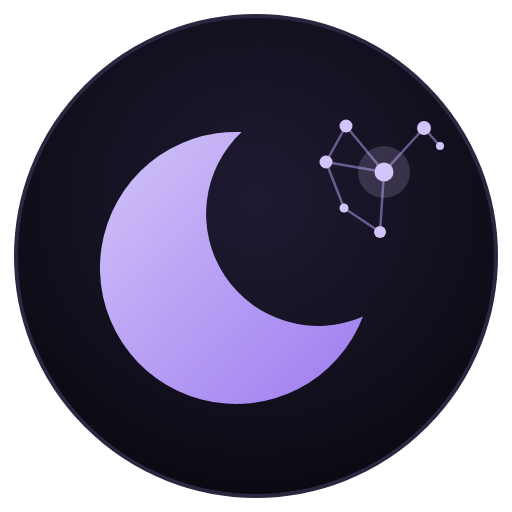 
    Moonshade
</h1>

    
    
    

<h3 align="center">
    
Um tema pessoal e despretensioso para o <a href="https://obsidian.md/">Obsidian</a> :3

    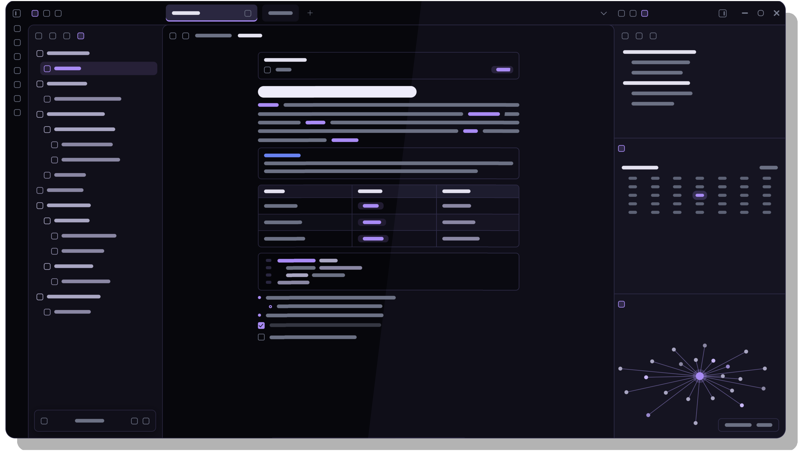
</h3>

---

### 📃 Prefácio

Este tema nasceu da necessidade de ter um cantinho calmo para escrever à noite: um roxo bem escuro, bordas discretas e um texto que não cansa os olhos. Foi feito primeiro para o meu próprio uso, então talvez não atenda a tudo o que você precisa. Mas, se ele combinar com o seu jeito de escrever e pensar, fico feliz em dividi-lo com você.

Para que ele possa ser seu também, deixei algumas opções no plugin **Style Settings**, onde você pode personalizar paletas de cor, tons de fundo, tipografia e mais. Sem o plugin, o tema funciona normalmente com o visual padrão.

Ele também é fruto de aprendizado. Usei ferramentas de IA como companhia durante o desenvolvimento, para entender melhor cada parte do CSS enquanto construía o tema. Ele continua evoluindo.

Fique à vontade para usar, adaptar ao seu gosto e sugerir melhorias. Seja bem-vindo(a).

---

### ✨ Características

O Moonshade é simples de propósito: não reinventa o Obsidian, só o deixa mais calmo para escrever à noite. Os detalhes que ele cuida:

- **Só modo escuro**, em roxo bem escuro, com dois tons de fundo.
- **Doze paletas** que trocam de uma vez o destaque e as cores de pastas e arquivos, e uma opção para trocar só a cor de destaque.
- **Cantos arredondados** ajustáveis de 0 a 20 px em abas, botões, tabelas, citações e molduras.
- **Explorador com ícones** para pastas, notas, Bases, Canvas e imagens, sem as etiquetas PNG ou BASE.
- **Abas compactas**, com a aba ativa maior e sublinhada na cor de destaque.
- **Notas bem acabadas:** títulos em degraus nítidos, tabelas, citações, callouts, blocos de código, propriedades e tags com a mesma borda e o mesmo arredondamento.
- **Tipografia à escolha:** fonte do texto, dos títulos, da interface e do código (com opção para desligar ligaduras), além do tamanho do texto, da altura da linha e da largura da coluna.
- **Interface leve:** barra de status e perfil do cofre em pílulas flutuantes (dá para voltar ao clássico), botões da janela em traço fino e barras de rolagem discretas.
- **Canvas, Bases e Kanban** estilizados no mesmo visual.
- **Animações suaves**, com velocidade ajustável, que respeitam a opção do sistema de reduzir movimento.
- **Exportação para PDF** em papel claro, mesmo com o tema escuro.
- **Funciona sem plugins.** O Style Settings só acrescenta as opções.

> [!IMPORTANT]
> O tema existe apenas no modo escuro, não aplicando nada no modo claro do Obsidian.

---

### 📥 Instalação

**Pelo Obsidian:**

1. Abra _Configurações → Aparência_ e, em _Temas_, clique em **Gerenciar**.
2. Procure por **Moonshade** e clique em **Instalar e usar**.

**Manualmente:**

1. Baixe `theme.css` e `manifest.json` deste repositório.
2. Coloque os dois arquivos em `<seu cofre>/.obsidian/themes/Moonshade/`.
3. Em _Configurações → Aparência_, selecione o tema.

**Opcional:** instale o plugin [Style Settings](https://github.com/mgmeyers/obsidian-style-settings) para personalizar fundo, paletas e muito mais.

---

### 🎛️ Personalização

Com o Style Settings instalado, as opções ficam em _Configurações → Style Settings → Moonshade_.

| Grupo | O que você ajusta |
| --- | --- |
| **Cores** | Paleta de cores, cor de destaque e tom do fundo |
| **Formato** | Arredondamento dos cantos e largura do texto da nota |
| **Texto e tabelas** | Tamanho do texto, altura da linha e espaçamento das tabelas |
| **Tipografia** | Fonte do texto, dos títulos, da interface e do código, e ligaduras |
| **Interface** | Barras de rolagem, velocidade das animações, rolagem suave, barra de status e perfil do cofre clássicos, e botão de menu |

---

### 🌑 Tons de Fundo

 

O Moonshade não tem modo claro, mas oferece dois tons de fundo escuros. A escolha muda a base de todo o Obsidian: painéis, barra lateral e editor.

- **Profunda:** o mais escuro, quase preto. Tem mais contraste com o texto e dá um ar mais intenso e marcante ao tema.
- **Noite:** um degrau mais claro, com um roxo-azulado que deixa tudo mais suave e calmo, como a noite. É a escolha para quem prefere menos contraste.

> [!NOTE]
> **Para trocar:** _Configurações → Style Settings → Moonshade → Tom do fundo._

---

### 🎨 Paleta de Cores

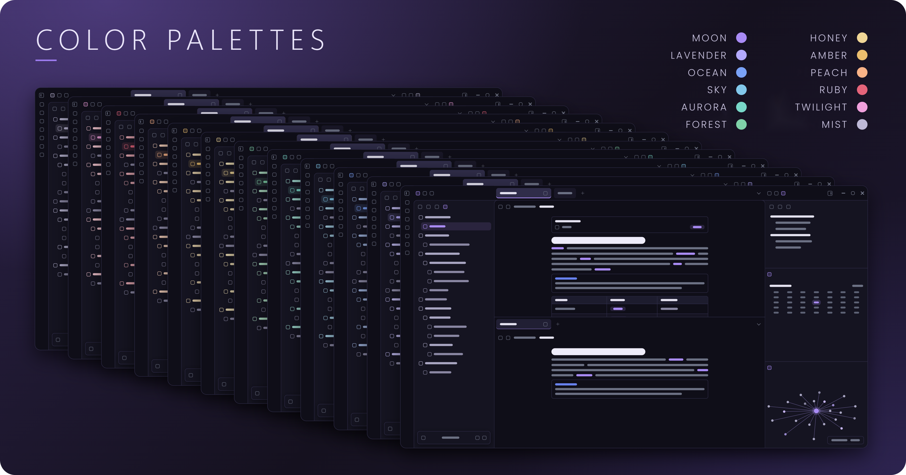 

O tema possui doze paletas de cores diferentes. As mudanças são sutis: pastas, arquivos, links, listas, borda da janela ativa, itens selecionados e tags, além de várias outras coisas.

<b>Lua</b> e <b>Lavanda</b>

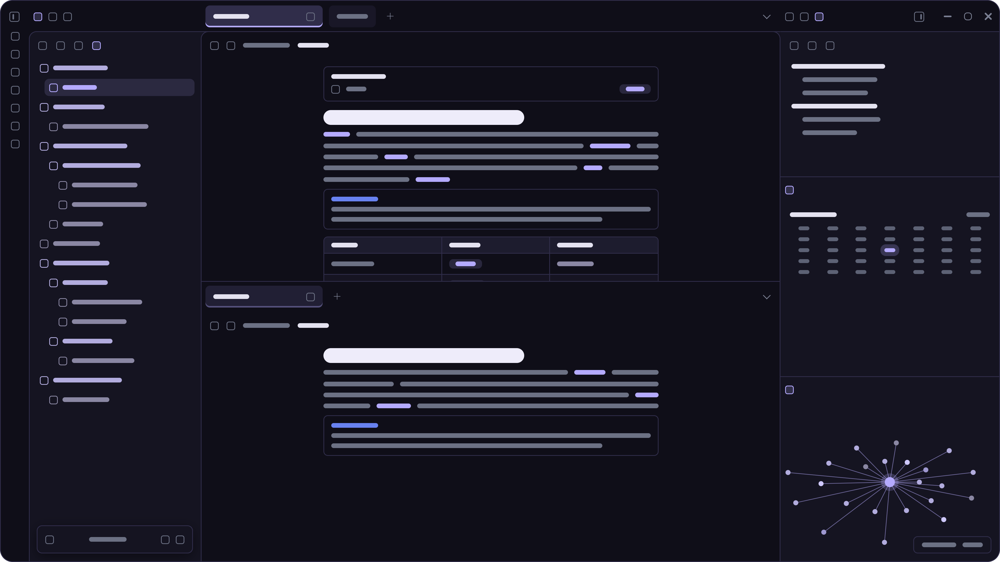

<b>Oceano</b> e <b>Céu</b>

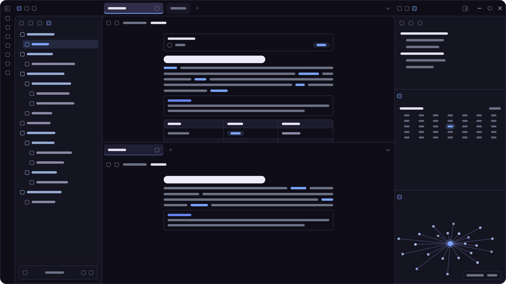
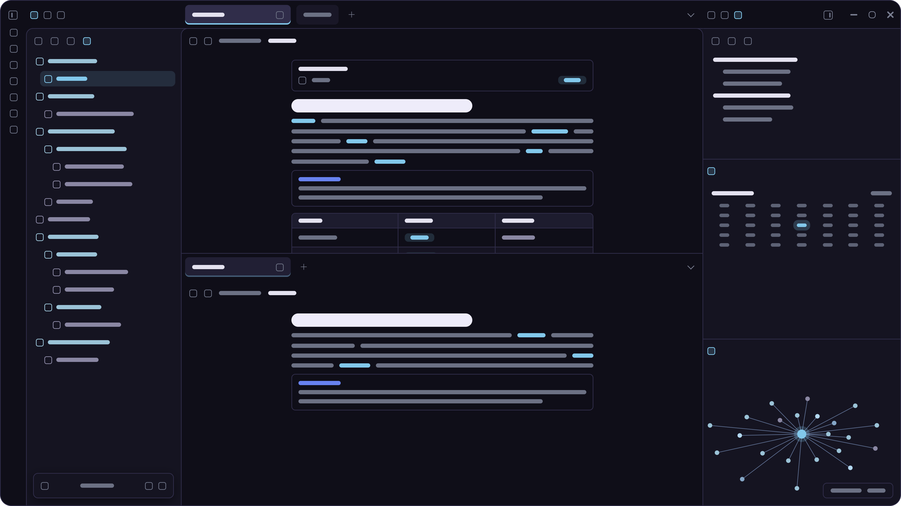

<b>Aurora</b> e <b>Bosque</b>

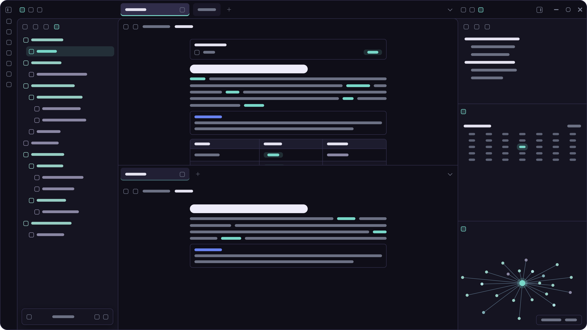
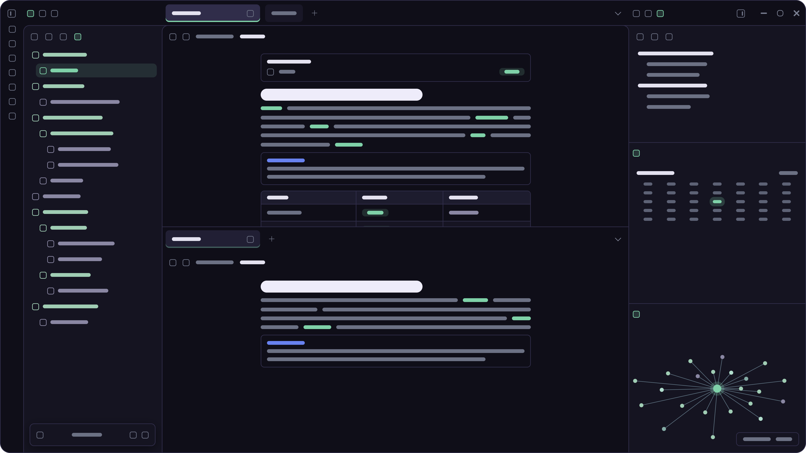

<b>Mel</b> e <b>Âmbar</b>

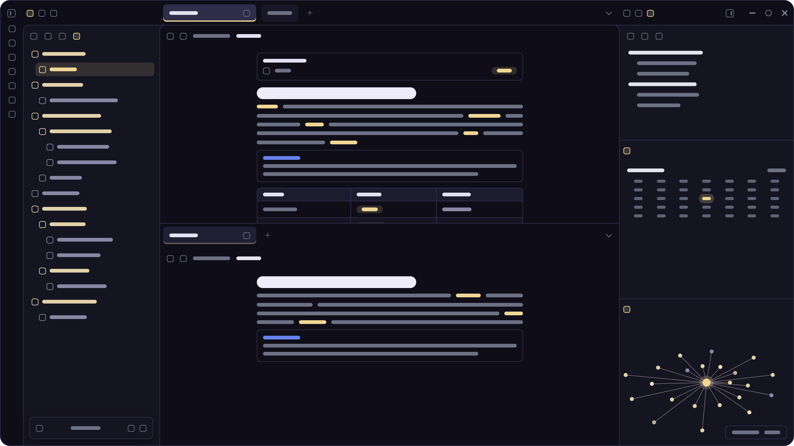

<b>Pêssego</b> e <b>Rubi</b>

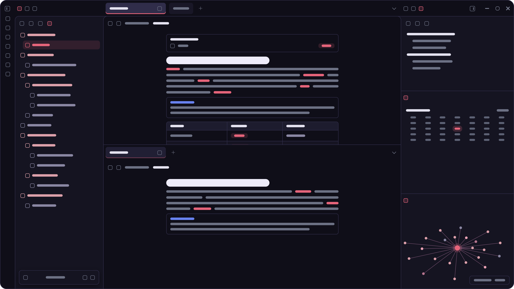

<b>Crepúsculo</b> e <b>Névoa</b>

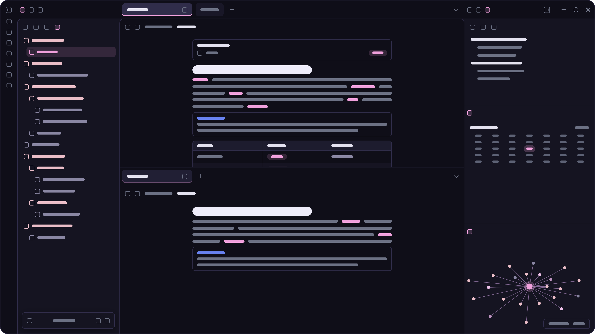
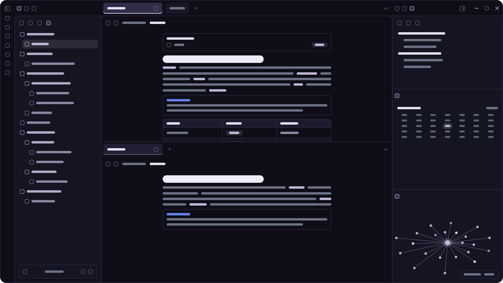

> [!NOTE]
> **Para trocar:** _Configurações → Style Settings → Moonshade → Paleta de cores._
> Para mudar só a cor de links, seleção e item ativo, use a opção **Cor de destaque**, logo abaixo.

---

### 🧩 Compatibilidade

| | |
| --- | --- |
| **Obsidian** | 1.4.0 ou superior (a estilização de Bases exige o Obsidian 1.9 ou superior) |
| **Modo** | Somente escuro |
| **Plugins** | Style Settings (opcional). Canvas, Bases e Kanban estilizados |
| **Plataforma** | Pensado para desktop. No celular funciona com ajustes básicos |

---

### ☕ Caso você goste do tema

Ele é gratuito e serve também como minha forma de aprendizado. Se quiser contribuir com um cafezinho (ou salvar minha coluna e as noites mal dormidas), o link está aqui:

---

### 📬 Feedback e Suporte

Encontrou um bug ou tem uma sugestão? Abra uma [issue](https://github.com/ibridd/moonshade/issues) no repositório.

---

### 📄 Créditos e Licença

- Licença [MIT](LICENSE).
- Ícones do explorador baseados no [Lucide](https://lucide.dev) (licença ISC).
- Personalização pelo plugin [Style Settings](https://github.com/mgmeyers/obsidian-style-settings), de mgmeyers.
